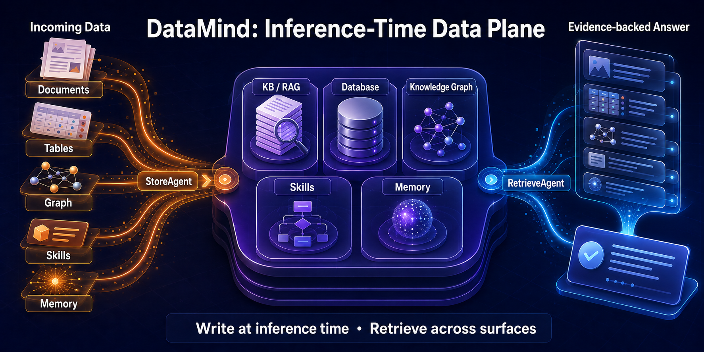

# DataMind

  <strong>边聊边入库，需要时跨数据面取证。</strong> 
  为 Agent 准备的 inference-time data plane：刚写入的数据，下一句话就能使用。

  
  
  
  

  <a href="#快速开始">快速开始</a> ·
  <a href="https://opendcai.github.io/DataMind-Doc/">完整文档</a> ·
  <a href="./plugins/datamind-context/">Codex Plugin</a> ·
  <a href="./README.md">English</a>

  

StoreAgent 负责写入；RetrieveAgent 跨数据面取证并回答。

> **v1.1.0** —— native + 本地 profile 存储是稳定基线；SDK/CCR 和远程数据库属于集成路径，请在目标环境中验证。

## Workspace Build 与多格式入库

对一个工作区可先用 `workspace_inspect` 盘点文件，再用 `surface_ingest_path` 统一路由：PDF/DOCX/PPTX 等文档进入 KB，CSV/TSV/XLSX 进入 SQL，文件包含、引用、版本、重复内容和显式 `depends_on` 进入 lineage Graph。`raw_file_read` 提供带 SHA-256 和分页偏移的原始证据读取；`build_start` → `build_freeze` → `build_verify` → `build_export` 保证构建结果可复现。旧式 `.doc/.ppt` 需要 LibreOffice 转换，Excel 保留表格结构，不转 PDF。

## 一句话理解

大多数 Agent 会取数，却没有一个地方放下刚刚学到的新事实。DataMind 把运行时拆成两个明确角色：

~~~text
新事实 / 文件 / CSV / 关系
            │
            ▼
       StoreAgent  ───── 写入 receipt ─────▶  KB · DB · Graph · Skills · Memory
            │
            │  下一句提问
            ▼
      RetrieveAgent  ◀── 答案 + evidence ─── 共享 data plane
~~~

这就是 **inference-time data**：不是训练数据，不是批处理 ETL，也不是无限增长的聊天记录，而是 Agent 运行期间可以更新、检查和复用的有界状态。

## 两个 Agent，一个硬边界

<table>
<tr>
<td valign="top" width="50%">

### StoreAgent

负责选择目标并写入：

- 文档与 chunks
- 行与数据表
- 图谱三元组
- profile 级 Skills
- 持久化 Memory

返回描述变更的 receipt。

</td>
<td valign="top" width="50%">

### RetrieveAgent

负责选择来源并读取：

- 语义知识库搜索
- SQL 检查与查询
- 图谱遍历
- Skills 与安全工具
- 按 scope 召回 Memory

返回带来源的 evidence。

</td>
</tr>
</table>

这个边界在代码层、工具到达模型前就已执行：RetrieveAgent 使用 read/utility 工具；StoreAgent 使用写工具，以及明确允许的 Skill 读取和输入检查工具。所有调用还会经过 `PathAllowlistHook`、`DestructiveSqlHook` 和 `AuditLogHook`。

## 五个数据面，一个答案

- **KB / RAG** —— 文档、制度、笔记与语义检索
- **Database** —— 精确数字、筛选、Join 与聚合
- **Knowledge Graph** —— 实体、关系与多跳事实；支持结构化三元组导入，
  也支持从文本文件或目录中有界抽取三元组
- **Skills** —— 可复用流程与安全工具
- **Memory** —— 偏好和长期事实，支持 `global`、`profile`、`session`

默认实现分别是 Chroma + BM25、SQLAlchemy（SQLite / MySQL / PostgreSQL）、NetworkX、profile 级 `SKILL.md` 和 SQLite Memory。

## 选择 DataMind 的使用方式

### 1. Codex Plugin —— 本地单人工作流

官方 Codex 适配位于 [`plugins/datamind-context`](./plugins/datamind-context/)。
它是一个薄 MCP 适配层，把 DataMind 的 RetrieveAgent、StoreAgent、RAG、
GraphRAG 和 Memory 能力提供给 Codex，并和 DataMind 共用 profile、配置及
存储。插件不包含第二套 DataMind runtime。

~~~bash
./scripts/install_codex_plugin.sh
~~~

这是使用个人文件和本地 Codex session 的最短路径。

`datamind_use_folder` 默认会把支持的文本文件写入 KB 并同步构建 Graph。
如果只需要图谱入库，可以使用 `datamind_graph_ingest`；每条生成的边都会保留
来源路径，重复入库时可按来源替换。

### 2. DataMind Service —— 并发、多 session 部署

当多个 session 或用户需要共享 data plane 时，运行 FastAPI 服务，或者把
DataMind 放到带鉴权的服务层后面。每个请求携带自己的 session 和 profile
上下文；多进程部署应选择可共享的数据库和存储后端。

~~~bash
python -m uvicorn datamind.server:app --host 0.0.0.0 --port 8000
~~~

本地 SQLite profile 适合作为单人基线。公网或团队部署还需要认证、授权、
TLS、限流和合适的共享后端，详见 [DataMind 文档站](https://opendcai.github.io/DataMind-Doc/)。

### 3. Python、CLI 与 HTTP API

需要把 DataMind 嵌入其他应用，或者直接从 Python、CLI、HTTP 调用时，使用
`pip install datamind`。

## 快速开始

~~~bash
pip install datamind

export DATAMIND__LLM__API_BASE=https://your-gateway.example.com
export DATAMIND__LLM__API_KEY=sk-...
export DATAMIND__LLM__PROTOCOL=anthropic   # 或 openai_chat_completions
export DATAMIND__LLM__MODEL=claude-sonnet-4-6

datamind chat
~~~

或者启动浏览器界面：

~~~bash
python -m uvicorn datamind.server:app --port 8000
# http://127.0.0.1:8000
~~~

协议必须显式设置，并会复用于外层 Agent loop 和内部生成（NL2SQL、multi-query、Memory、图谱抽取）。

可选扩展

~~~bash
pip install 'datamind[mysql]'
pip install 'datamind[postgres]'
pip install 'datamind[voyage]'
pip install 'datamind[huggingface]'
pip install 'datamind[dev]'
~~~

## 60 秒跑通完整 Demo

~~~bash
git clone https://github.com/OpenDCAI/DataMind.git
cd DataMind
python -m venv .venv && source .venv/bin/activate
pip install -e .

cp .env.datamind.example .env.datamind
$EDITOR .env.datamind              # 至少设置 DATAMIND__LLM__API_KEY

python -m datamind.scripts.hello_sdk
python -m datamind.scripts.seed_enterprise_demo
DATAMIND__DATA__PROFILE=enterprise_demo \
  python -m datamind.scripts.hello_enterprise
~~~

内置数据集包含 17 篇文档、64 个图谱节点、6 张表和 101 行数据。想看 UI：

~~~bash
DATAMIND__DATA__PROFILE=enterprise_demo \
  python -m uvicorn datamind.server:app --port 8000
~~~

把 `.md`、`.csv` 或 `.txt` 拖进去，提问并观察工具调用。完整流程请查看 [DataMind 文档站](https://opendcai.github.io/DataMind-Doc/)。

## 对话本身就能改变 data plane

~~~text
你            → “把 sales-q2.csv 导入成数据表 q2_sales”
StoreAgent   → db_import_csv(...) → 写入 receipt
你            → “哪个 sales rep 的 Q2 pipeline 最大？”
RetrieveAgent → db_query_sql(...)  → 答案 + 表格 evidence
~~~

文档、图谱事实和 profile 级 Skills 也遵循同一模式。

## 选择运行时

稳定默认值是内置 `native` loop；需要 Subagents 或 Compaction 时，再选择可选的 `sdk` loop。

| Backend | 协议 | 状态 |
|---|---|---|
| `native` | Anthropic `/v1/messages` | **Stable** |
| `native` | OpenAI `/v1/chat/completions` | **Stable** |
| `sdk` | Anthropic | Integration |
| `sdk` | OpenAI 兼容 + CCR | Integration |

请显式设置：

~~~bash
DATAMIND__AGENT__BACKEND=native
DATAMIND__LLM__PROTOCOL=anthropic
~~~

完整边界见 [native / SDK 支持矩阵](https://opendcai.github.io/DataMind-Doc/)。SDK + OpenAI 格式路径使用 [CCR](https://github.com/musistudio/claude-code-router) 做本地协议桥接。

## Python 与 HTTP API

~~~python
from datamind.agent import build_datamind
from datamind.config import Settings

async def answer() -> str:
    system = await build_datamind(Settings())
    try:
        await system.ingest("Remember that weekly reports use Chinese.")
        result = await system.query("What language should weekly reports use?")
        return result["answer"]
    finally:
        await system.aclose()
~~~

内置 FastAPI 服务提供 `GET /api/health`、`GET /api/tools`、`POST /api/ask`、`POST /api/store`、`POST /api/chat`（SSE）和 `POST /api/upload`。详见[稳定 API](https://opendcai.github.io/DataMind-Doc/)。

## 安全地嵌入，不要裸奔到公网

DataMind 期待你在边缘层提供认证与授权。公网部署前请阅读[安全边界](https://opendcai.github.io/DataMind-Doc/)：

- 本地使用绑定 loopback；
- 在边缘层加入认证、授权、TLS 和限流；
- 隔离 profile/storage 与上传路径；
- provenance 是来源元数据，不是权限凭证。

## 本地验证

~~~bash
pytest
python -m datamind.scripts.verify_sqlite_demo
~~~

CI 会运行无网络测试和确定性的 SQLite demo。长跑评测、checkpoint/resume 与 benchmark 见 [BENCHMARK_RUNNER](./docs/BENCHMARK_RUNNER.md)。

## 从这里继续

<table>
<tr>
<td valign="top" width="50%">

**开始构建**

- [完整上手](https://opendcai.github.io/DataMind-Doc/)
- [稳定 API](https://opendcai.github.io/DataMind-Doc/)
- [native / SDK 支持矩阵](https://opendcai.github.io/DataMind-Doc/)

</td>
<td valign="top" width="50%">

**理解概念**

- [术语与概念](https://opendcai.github.io/DataMind-Doc/)
- [公网部署安全边界](https://opendcai.github.io/DataMind-Doc/)
- [CHANGELOG](./CHANGELOG.md)

</td>
</tr>
</table>

更多架构说明和教程见 [DataMind-Doc](https://opendcai.github.io/DataMind-Doc/zh/)。v1.x 支持入口位于 `datamind/`；原始 v0.1 原型仍保留用于对照。

## License

DataMind 基于 [Apache License 2.0](./LICENSE) 发布。

PDF 解析支持可选的 MinerU API 优先适配；未安装或解析失败时自动回退到 `pypdf`。通过 `DATAMIND_MINERU=off` 可强制只使用 `pypdf`，`DATAMIND_MINERU_API_URL` 和 `DATAMIND_MINERU_API_TIMEOUT_S` 可指定 API 地址和超时。
